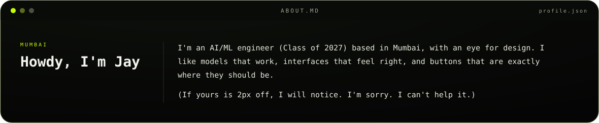
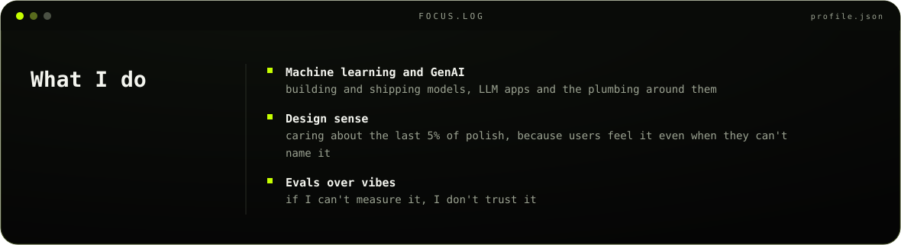
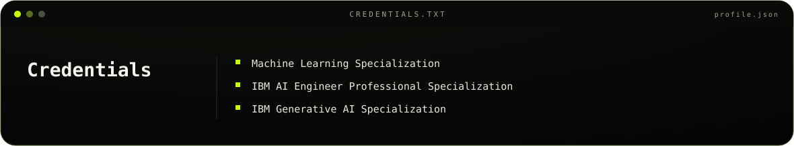
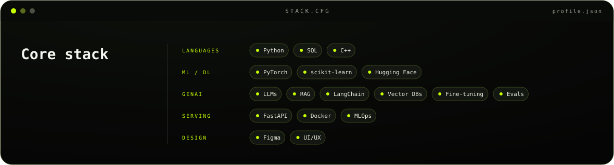
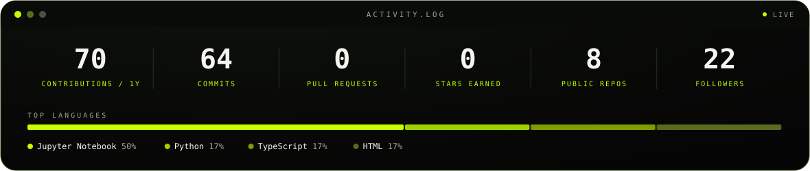

 <picture> 
  <source media="(prefers-color-scheme: dark)" srcset="assets/dark.svg">
  <source media="(prefers-color-scheme: light)" srcset="assets/light.svg"> 
  
</picture> 

 

 
  <picture>
  <source media="(prefers-color-scheme: dark)" srcset="./assets/section-about-dark.svg"> 
  <source media="(prefers-color-scheme: light)" srcset="./assets/section-about-light.svg">
  
</picture> 

 
  <picture>
  <source media="(prefers-color-scheme: dark)" srcset="./assets/section-focus-dark.svg"> 
    <source media="(prefers-color-scheme: light)" srcset="./assets/section-focus-light.svg"> 
    
  </picture> 

  
 
    <picture> 
      <source media="(prefers-color-scheme: dark)" srcset="./assets/section-credentials-dark.svg">
      <source media="(prefers-color-scheme: light)" srcset="./assets/section-credentials-light.svg"> 
       
    </picture> 
 
    

      <picture> 
        <source media="(prefers-color-scheme: dark)" srcset="./assets/section-stack-dark.svg"> 
        <source media="(prefers-color-scheme: light)" srcset="./assets/section-stack-light.svg">
         
      </picture> 

---

## Technical Toolkit

**AI & Machine Learning**

**Software Engineering**

**Design**

---

## GitHub activity

 <picture>
  <source media="(prefers-color-scheme: dark)" srcset="./assets/stats-dark.svg"> 
  <source media="(prefers-color-scheme: light)" srcset="./assets/stats-light.svg"> 
  
</picture> 

 

 <picture> 
  <source media="(prefers-color-scheme: dark)" srcset="https://raw.githubusercontent.com/j-xingh/j-xingh/output/snake-dark.svg"> 
  <source media="(prefers-color-scheme: light)" srcset="https://raw.githubusercontent.com/j-xingh/j-xingh/output/snake-light.svg"> 
   
</picture> 

## Connect

- 
- 
- 
- 

Fun fact: this README passed review only after I fixed the alignment twice.

  

