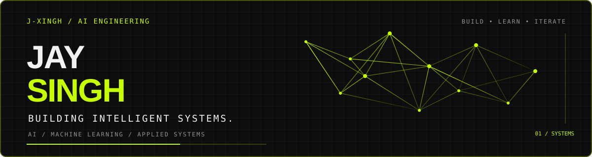

  

  <strong>AI ENGINEERING &nbsp; / &nbsp; MACHINE LEARNING &nbsp; / &nbsp; APPLIED AI</strong>

---

## About

I'm a final-year Electronics and Computer Science engineering student building toward **AI engineering and applied machine learning**.

My work sits at the intersection of intelligent systems and practical software. With a background in UX/UI design, I care about both how a system works and how people interact with it.

I value clear thinking, sound engineering, honest evaluation, and software that solves real problems.

**Based in Mumbai, India.**

[Email](mailto:jays.work1114@gmail.com) · [LinkedIn](https://www.linkedin.com/in/jay-singh1114) · [GitHub](https://github.com/j-xingh)

---

## Technical Toolkit

**AI & Machine Learning**

**Software Engineering**

**Design**

---

## GitHub Activity

  

---

  <strong>BUILD WITH INTENT. EVALUATE WITH RIGOR.</strong>
    
  <a href="mailto:jays.work1114@gmail.com">GET IN TOUCH ↗</a>

